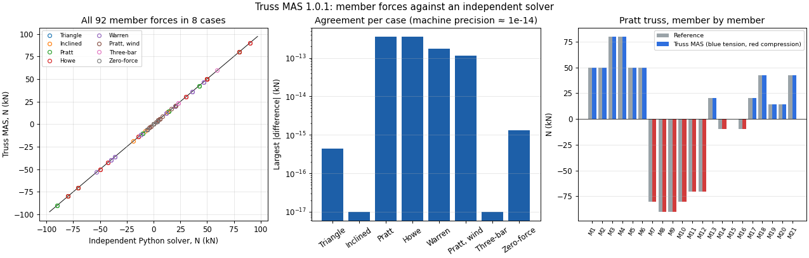

<p align="center"></p>
<h1 align="center">Truss MAS</h1>
<p align="center"><b>Free 2D truss analysis with a 3D view. Version 1.0.1.</b><br>Draw a truss or load an example, assign supports and loads, and get member forces, reactions, displacements, stresses and equilibrium checks, then save a PDF report.</p>
<p align="center"><a href="https://al-shahriar-12.github.io/truss-mas/"><b>Open Truss MAS</b></a> · <a href="#verified-results">Verification</a> · <a href="#source-code">Source code</a></p>

## Features
- **Model:** draw joints and members on a snapping grid (tap joint to joint), or type coordinates in tables; pin and roller supports (horizontal or vertical surface) with optional prescribed displacements; joint loads in several load cases; optional self-weight; materials (E, density, fy) and sections (A) per member.
- **Analysis:** a genuine direct-stiffness truss solver: two translational degrees of freedom per joint, element stiffness (EA/L)[c² cs; cs s²], LU solve with partial pivoting (no matrix inverse), reactions R = KU − F, axial force N = (EA/L)[−c −s c s]·u. Runs instantly after every change, or on demand with **Run analysis** (results are marked out of date when the model changes).
- **Checks:** validation before solving (missing references, zero-length members, invalid properties, no supports, isolated joints, disconnected parts), exact mechanism detection naming the free joint and direction, force and moment equilibrium, solver residual and element force-recovery check. A result is marked *verified* only when all pass.
- **Results:** members coloured blue (tension), red (compression) or grey (zero force) with labels, width proportional to |N|; reactions and the deformed shape (scale stated); a sortable, filterable member table (N, state, stress, strain, elongation) linked to the drawing; reactions and displacement tables; a **3D view** (three.js) of the truss and its forces.
- **Output:** `.frmas` project files (the MAS Studio format), PDF report, CSV tables, PNG drawing; SI (kN, m, mm²) or US (kip, ft, in²) units; light and dark themes; installs as an app and works offline.

## Verified results
The engine is tested with Vitest (`npm test` in the source code): 24 tests covering axial bars, prescribed displacements, self-weight, all nine examples against an independent Python solver (`tests/reference.py` in the source code), closed forms, diagnostics, units, file round trips and result invalidation. All 24 pass.



| Case | Quantity | Closed form or reference | Truss MAS |
| --- | --- | --- | --- |
| Pratt truss, 6 panels | end diagonal | −50√2 = −70.710678 kN | −70.710678 kN |
| Triangular truss | AC | −5√13/3 = −6.009252 kN | −6.009252 kN |
| Three-bar, steel and aluminium | centre bar | P·EA_c/(EA_c + 2EA_s cos³θ) = 59.453209 kN | 59.453209 kN |
| All 92 member forces in 8 cases | largest difference | independent solver | 3.6 × 10⁻¹³ kN |

Accessibility: 0 violations of the automated WCAG 2.2 AA rules (axe-core) in light and dark themes.

## Examples
Files named `example-*.frmas`: open them with **Open** in the app (they are also under **New from example**).

## Source code
`truss-mas-source.zip` holds the React + TypeScript project. Unzip it, then:

```bash
npm ci          # install
npm test        # 24 engine tests
npm run build   # one self-contained dist/index.html
```

## Limitations
Linear elastic, small displacements, pin-jointed members with loads at joints. Buckling of compression members, connection design and code checks are not included. Tested in Chromium (desktop and phone sizes); Safari and Firefox untested. For learning and checking, not certified design.

## Also from MAS Studio
[Flexure MAS](https://al-shahriar-12.github.io/flexure-mas/) · [Frame MAS](https://al-shahriar-12.github.io/frame-mas/) · [Beam-Frame MAS](https://al-shahriar-12.github.io/beam-frame-mas/) · [BNBC Frame MAS](https://al-shahriar-12.github.io/bnbc-frame-mas/) · [Beam-Frame-Truss MAS](https://al-shahriar-12.github.io/beam-frame-truss-mas/)

## Author
**MD Al Shahriar**, BSc. in Civil Engineering, Bangladesh University of Engineering and Technology (BUET) · MAS Studio · [@Al-Shahriar-12](https://github.com/Al-Shahriar-12)

MIT licence. If this app helped you, please remember its author in your duas.
